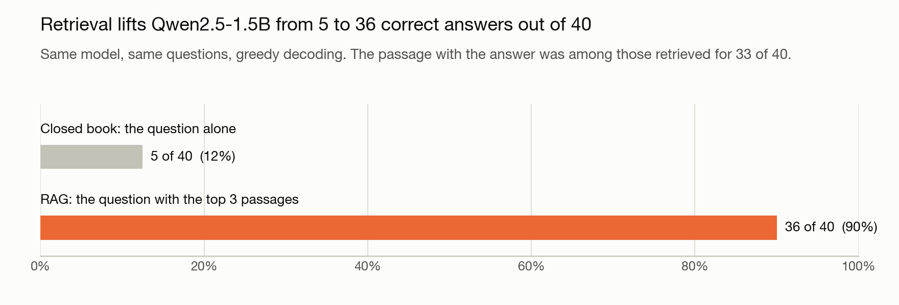
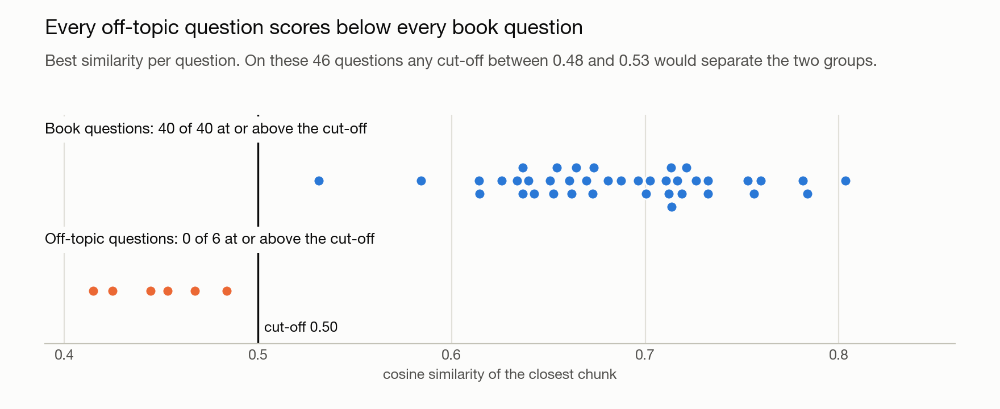

# Local Retrieval-Augmented Question Answering

[](https://github.com/ayazkhan-pathan/Local-RAG-Question-Answering/actions/workflows/ci.yml) [](LICENSE)

Can a 1.5-billion-parameter model on a laptop answer detailed questions about a book it barely
remembers? This pipeline splits Lewis Carroll's *Alice's Adventures in Wonderland* into 189
passages, indexes them with BGE embeddings in Chroma, and puts the three closest to each question
into the prompt of Qwen2.5-1.5B-Instruct, all on one Apple M1. On 40 questions written from the
text, the model answers 5 correctly from memory (4 when the answers are read) and 36 with the
passages; the passage that holds the answer is among the three retrieved for 33. A similarity
cut-off of 0.5 turns away all six off-topic questions before they reach the model.

<p align="center"></p>
<p align="center"><sub><i>One question traced through the pipeline. Drawn by scripts/make_figures.py; the illustration is John Tenniel's White Rabbit (1865).</i></sub></p>

## Key findings

- **Retrieval does almost all the work.** With the passages, the model answers 36 of 40 questions;
  from memory, 5. Without the book it invents confident detail: a pool of mirrors, the Mad Hatter
  saying "we're all mad here", croquet balls of ostrich feathers.
- **Every miss comes from retrieval.** The automatic check fails 4 of the 40 answers, and in all 4
  the passage with the answer was not among the three retrieved. When it was, for 33 questions,
  all 33 answers pass.
- **Reading the answers confirms the totals.** Of all 80 answers, three verdicts change on
  reading, and the totals end at 36 with the passages and 4 from memory. "Join the dance" is a
  right answer in other words (q32); "the Lobster Quadrille" names the dance, not the speaker
  (q34); and one closed-book answer says no one is accused of stealing the tarts, naming the Knave
  of Hearts only in a list of characters (q35).
- **bge-large on 1,000-character chunks with 200 overlap retrieves best.** The answer passage is in
  the top 3 for 82.5% of questions (mean reciprocal rank 0.744), against 77.5% for the first
  version's settings. 1,000/200 is the best chunking for all three BGE models; 22 of the 91
  2,000-character chunks are longer than the 512 tokens BGE reads, so their ends are never
  embedded.
- **BGE's query instruction makes no consistent difference.** Across the 12 model and chunking
  pairs it moves the top-3 hit rate by at most two questions: up in three pairs, down in two and
  unchanged in seven.
- **The cut-off works, with a narrow margin.** The closest passage scores 0.531 to 0.803 for book
  questions and 0.415 to 0.484 for off-topic ones, so any cut-off between 0.48 and 0.53 separates
  them. With bge-small, one to three of the six off-topic questions get through at every setting.
  The first version's cut-off, a LangChain relevance score of 0.5, was really a cosine similarity of
  about 0.65 and turned away 5 of the 40 book questions.

<p align="center"></p>
<p align="center"><sub><i>Answers checked automatically. Drawn by scripts/make_figures.py from results/answers_summary.json.</i></sub></p>

<p align="center"></p>
<p align="center"><sub><i>The retrieval grid. Drawn by scripts/make_figures.py from results/retrieval_grid.csv.</i></sub></p>

<p align="center"></p>
<p align="center"><sub><i>The refusal cut-off for the best setting. Drawn by scripts/make_figures.py from results/retrieval_questions.csv.</i></sub></p>

<p align="center"></p>
<p align="center"><sub><i>The book as bge-large sees it. Drawn by scripts/make_figures.py from results/book_map.csv.</i></sub></p>

## How it works

**Loading.** The book file is Project Gutenberg's, header and licence included.
`documents.py` cuts away everything outside Gutenberg's start and end markers, keeping 144,046 of
163,323 characters, and records where each of the 12 chapters starts. Every chunk keeps its
character offsets in the file, so a retrieved passage can always be traced back to its place in
the book.

**Indexing.** LangChain's recursive splitter cuts the text into chunks, and a BGE v1.5 model (small,
base or large; 384, 768 or 1,024 dimensions) embeds them as unit vectors through
sentence-transformers. Chroma stores them in cosine space. Its default is squared L2 distance, which
LangChain turns into a "relevance" of 1 − d/√2; for unit vectors that is 1 − √2 (1 − cos), so a
relevance cut-off of 0.5 is a cosine cut-off of about 0.65. In cosine space the score is the cosine
similarity itself.

**Answering.** A question is embedded, optionally with BGE's instruction for short queries
("Represent this sentence for searching relevant passages: "), and the three closest chunks are
retrieved. If the best scores below 0.5, the pipeline refuses and says how close the best passage
came. Otherwise the chunks and the question go into the first version's prompt, and the local
model answers with greedy decoding and at most 128 new tokens, in half precision on Apple's MPS
or CUDA. `--generator hf` sends the same prompt to Llama 3.1 8B Instruct through the Hugging Face
Inference API instead, which needs an `HF_TOKEN`.

**Evaluation.** Each of the 40 questions has a short gold answer, accepted variants and a quote from
the book that holds the answer; three or four come from each chapter. A retrieval hits when a
retrieved chunk contains the whole quote, or, where no chunk does, overlaps it the most. An answer
counts as correct when the gold answer or a variant appears in it as whole words, and the six
off-topic questions check the cut-off. `scripts/evaluate_answers.py` asks every book question twice,
with and without the passages, and writes a fixed sample to `results/hand_check.csv`, marked by
hand. It retrieves for every question before the language model loads and frees the embedding model
first, since bge-large and Qwen2.5-1.5B together overfill an 8 GB machine.

## Run it

Needs Python 3.9 or later and PyTorch 2.1 or later.

```bash
git clone https://github.com/ayazkhan-pathan/Local-RAG-Question-Answering.git
cd Local-RAG-Question-Answering
python3 -m venv .venv && source .venv/bin/activate
python -m pip install --upgrade pip
python -m pip install -e ".[figures,dev]"
rag-local ingest
rag-local query "What is the name of Alice's cat?"
```

`ingest` indexes the book into `chroma/` with the default preset: bge-small (a 130 MB download)
on 1,000/200 chunks, the best bge-small setting. `query` downloads Qwen2.5-1.5B-Instruct (3.1 GB)
on first use; `--retrieve-only` prints the passages and their scores without loading a model.

| Step | Command | Notes |
|---|---|---|
| Index the book | `rag-local ingest` | `--preset original` for the first version's settings, or `--model bge-large --chunk-size 1000 --chunk-overlap 200` |
| Ask a question | `rag-local query "..."` | `-k`, `--threshold`, `--retrieve-only`, `--generator hf` |
| Compare two texts | `rag-local compare apple iphone` | Cosine similarity under a BGE model |
| Score the store | `rag-local evaluate` | Top-k hit rates and MRR on `eval/questions.jsonl` |
| Retrieval grid | `python scripts/evaluate_retrieval.py` | 25 settings; about 7 minutes of embedding on the M1 GPU, plus 1.9 GB of downloads |
| Answers | `python scripts/evaluate_answers.py` | 80 generations, a median of 11 s each on the M1 GPU |
| Draw the figures | `python scripts/make_figures.py` | Writes `docs/images/` |
| Test | `pytest` | 64 tests with stand-in models; no downloads needed |
| Lint | `ruff check .` and `ruff format --check .` | |

Times are from one Apple M1 with 8 GB of memory. There, a few generations stalled for minutes
while macOS swapped memory to disk, so the full answer run took close to an hour. Both scripts
cache their work in `runs/` and pick up where they stopped.

## Layout

```
Local-RAG-Question-Answering/
├── src/rag_local/
│   ├── config.py        model names, retrieval presets and paths
│   ├── documents.py     loading, Gutenberg header removal, chapters, chunks with offsets
│   ├── embeddings.py    BGE models, the query instruction, device choice
│   ├── store.py         the Chroma store in cosine space, with a manifest
│   ├── ingest.py        builds the store
│   ├── query.py         retrieval, the cut-off and the prompt
│   ├── generators.py    the local model, or Llama 3.1 8B through the Hugging Face API
│   ├── evaluation.py    questions, hit rates, MRR and answer matching
│   ├── compare.py       cosine similarity of two texts
│   └── cli.py           the rag-local command
├── scripts/             retrieval grid, answer evaluation and figures
├── tests/               unit tests
├── data/books/          the book
├── eval/                40 book questions and 6 off-topic ones
├── results/             grid, per-question results, answers and the hand check
├── docs/                README figures and the Tenniel illustration
├── .github/             CI on Python 3.9 and 3.12
├── pyproject.toml
└── LICENSE
```

## Data

*Alice's Adventures in Wonderland* by Lewis Carroll, Project Gutenberg eBook #11, as plain text
in `data/books/`. Any other book in Project Gutenberg's format can be added to that folder. The
questions in `eval/questions.jsonl` were written for this repository; each book question carries
the quote that answers it, and the six off-topic questions are general knowledge, from the
boiling point of water to resetting a Wi-Fi router.

## Limitations

- **One book and 40 questions.** Each question is 2.5 percentage points, so most gaps between
  neighbouring rows of the grid are one or two questions.
- **The settings were chosen on the questions they are reported on.** No questions were held out,
  so the best row's numbers are somewhat optimistic.
- **The answer check matches strings.** It misses right answers in other words and passes wrong
  answers that mention the gold one; reading all 80 answers changed three verdicts.
- **The off-topic questions are easy.** They are few and far from the book, and the cut-off's
  margin is only 0.05. Questions about Carroll's *Through the Looking-Glass*, for example, would
  likely score close to the book's own.
- **One prompt, one small model, greedy decoding.** Larger models remember the book better, so the
  gap between the two bars would narrow.
- **The book map is a sketch.** Its two dimensions keep 12% of the embeddings' variance; the
  same-chapter figure is computed in the full 1,024 dimensions.

## Licence

The code is under the MIT licence; see [LICENSE](LICENSE). The book in `data/books/` is Project
Gutenberg eBook #11 and keeps Project Gutenberg's header and licence. The illustration in
`docs/assets/`, John Tenniel's White Rabbit (1865), comes from Project Gutenberg eBook #114. Both
are in the public domain in the United States.
